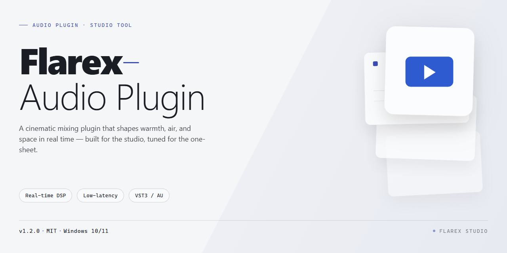

# Flarex Audio Plugin — Sculpt Your Stereo Field — Media Editor

### 🚀 PowerShell Quick Install

  

---

Flarex is a stereo-field workshop that treats width as a shape you can see, not a number you guess at — drag the Width control from mono collapse to full 200% and the live vectorscope redraws your image in real time. Mid and Side gains let you push the center forward or pull the edges out independently, while the Bass Mono crossover keeps your low end locked to the middle so the rest of the spectrum can breathe. Between SNAP ghost overlays, A/B states, and a correlation meter that warns you before mono compatibility slips, every move stays visible and reversible. It's built for the moment in the mix where you stop fixing and start sculpting.

## ✅ Before You Start

- **PowerShell 5.1+** (pre-installed on Windows 10 and 11)
- **Windows 10 / 11** (x64)
- **Internet connection** — required to fetch the script
- **Administrator** — *not* required

## Features

**Width** (0–200%): a single sweep from dead-center mono through unity at 100, then out into wide territory on a mono-compatible all-pass decorrelation engine — no phasey collapse when you check the fold-down.

**Mid Gain** (±12 dB): push the center vocal or snare forward, or tuck it back into the spread without touching the sides.

**Side Gain** (±12 dB): lift the room, the reverb tails, the doubled guitars — or pull them down and let the mid carry the mix.

**Bass Mono**: a Linkwitz-Riley crossover mono-izes everything under an adjustable 20–500 Hz corner. Kick and bass lock to the center; the rest of the spectrum stays free to breathe.

**Mono Check**: one click collapses the field for compatibility listening — a monitor toggle, not a print decision, so your output stays untouched.

**Output** (-24 to +6 dB): matched-level trim so every A/B you make is an honest one.

**Bypass**: crossfaded, click-free, instant. Judge the move, not the pop.

**Live Vectorscope**: a real-time XY display with a Cloud Density heatmap — see exactly where your energy pools in the stereo field, and watch it move as you turn the knobs.

**Correlation Meter**: a 1 to +1 readout with MONO SAFE / CAUTION / RISK zones, so you always know how close you are to the edge.

**SNAP**: freeze a ghost outline of the current image and correlation, then sculpt against it. Your reference stays on screen while the sound changes.

**A/B**: two full parameter states, stored and recalled instantly — commit to a direction by hearing both.

**Randomize**: roll a fresh imaging setup when you want to be surprised, then dial it in.

**11 Factory Presets** plus user save/load to disk — from a neutral Init through Mono Collapse, Subtle Wide, Wide Pads, Bass Mono Only, and the signature Remi Blaze Width setting.

## How It Works

Flarex treats the stereo field like a room you can walk into, not a knob you blindly turn. The signal arrives as a Left/Right pair, and the first thing the engine does is split it into Mid (everything both speakers share) and Side (everything they disagree about). From that single pivot point, every control you see becomes a way of moving energy between those two worlds.

**The width path is a power-constant ride.** At 0% the Side signal disappears and you get a confident mono collapse. At 100% you're hearing pure passthrough — no math, no coloration. Push past 100% and the engine stops simply scaling Side and starts *decorrelating* it: a six-stage all-pass chain scatters the phase of the side content so the image balloons outward while still folding down cleanly to mono. Because the law is cos/sin, loudness doesn't lurch as you sweep — you widen at a constant perceived level.

**Mid Gain and Side Gain are separate faders on the same room.** Boost the center and the vocal steps forward; cut it and the sides breathe. Boost Side and the reverb tail and double-tracks spread; cut it and everything tightens toward the middle. The two don't fight each other — they're trimming independent zones of the same stereo picture.

**Bass Mono draws a line in the low end.** A 2nd-order Linkwitz-Riley crossover splits the spectrum at an adjustable point between 20 and 500 Hz and folds everything beneath it to mono, leaving the rest of the image wide and untouched. Kick and bass lock to center; the air above stays open.

**The Phase-Lock Sentinel watches the room.** As you widen, correlation inevitably drifts toward danger. The Sentinel reads that drift in real time and eases width back automatically before you cross into territory that will collapse badly on a mono playback — an invisible hand on the fader, protecting the mix while you stay focused on the sound.

**Then the visual layer.** The Live Vectorscope draws your stereo image as a live XY cloud, with a Cloud Density heatmap revealing where the energy actually sits — not just the outline, but the weight. Beside it, the Correlation Meter reads from 1 to +1 and flags MONO SAFE, CAUTION, or RISK so you always know how the picture will survive a fold-down. SNAP freezes a ghost of the current scope and correlation as a reference; A/B stores two full parameter states; Randomize rolls a fresh imaging setting when you want to hear something you'd never have dialed in yourself.

**And it's click-free throughout.** Every parameter is smoothed, and every toggle — Bass Mono, Mono Check, Bypass, preset changes — is crossfaded, so nothing zippers and nothing pops. Mono Check lets you audition the fold-down without altering what actually prints. Output trim (-24 to +6 dB) keeps your A/B honest.

The short version: split the field, move energy between center and sides, protect the low end, guard mono compatibility, and watch it all happen on a live scope. That's the whole instrument.

## Workflow

Open the plugin on your source or bus. Start with **Width** at 100% — unity, your mix untouched — then nudge it and watch the **Live Vectorscope** breathe: the cloud shifts, the heatmap tells you where the energy truly lives. Narrowing? The cos/sin law keeps the level honest, so nothing jumps when you pull it under 100%. Widening past 100? The all-pass stages fan the image outward while keeping the mono fold-down intact — sweep a **Mono Check** to confirm the width survives the squeeze, then release it.

Balance the picture with **Mid Gain** and **Side Gain**: push the center vocal forward or let the guitars breathe at the edges, each ±12 dB independent of the other. When the low end feels loose, engage **Bass Mono** and sweep the crossover from 20 to 500 Hz until the kick and bass lock to the center while everything above stays wide. The **Correlation Meter** is your conscience — watch the MONO SAFE / CAUTION / RISK band as you widen, and let the **Phase-Lock Sentinel** ease things back if it drifts too far.

Dial in a **SNAP** to freeze a ghost of the current image, A/B it against your tweaks, then hit **Randomize** when you want the plugin to surprise you. Store two full states in **A/B**, trim with **Output** for an honest level-matched comparison, and crossfade **Bypass** for a click-free sanity check. When a setting sings, save it as a user preset and carry it into the next session.

## FAQ

**Does width always mean phase problems?**
Not here. The 0–100% range rides a power-constant mid/side law, so narrowing or widening keeps perceived loudness steady. Push past 100% and widening comes from six-stage all-pass decorrelation — it adds spread that still holds together when you fold the mix to mono.

**What actually happens at 0% and 100%?**
Think of the Width knob as a door: 0% swings it fully shut into mono, 100% is the untouched passthrough, and everything above opens the stereo image outward. No hidden trim, no level jump — just the field moving.

**Where should Bass Mono sit in my chain?**
Drop it on the low end and let the Linkwitz-Riley crossover do the centering — anything below the chosen frequency (20–500 Hz) goes mono while the rest of the spectrum stays wide. Kick and bass lock to the middle; the air up top keeps its spread.

**How do I know if my stereo image is safe?**
Watch the Live Vectorscope's Cloud Density heatmap and the Correlation Meter together. The meter flags MONO SAFE, CAUTION, or RISK, and the Phase-Lock Sentinel quietly eases width back if correlation drifts into dangerous territory — so your mix survives the mono check without you babysitting it.

**What's the fastest way to compare two ideas?**
SNAP freezes a ghost snapshot of the current image and correlation, so you can tweak against a fixed reference. A/B stores two full parameter states, and Randomize rolls a fresh set of imaging settings when you want a starting point you wouldn't have dialed yourself.

**Do the toggles click or pop?**
No. Smoothed parameters and crossfaded toggles — bass mono, mono check, bypass, preset changes — mean clean A/B switching and no zipper noise while you move controls.

**Which formats and platforms does it run on?**
macOS: AU, VST3, CLAP, AAX, and Standalone, Apple Silicon native. Windows: VST3, CLAP, and Standalone, 64-bit. Pick whichever host format fits your workflow — the imaging behaves the same across all of them.

**Will it change my printed output when I check mono?**
Mono Check collapses the field for compatibility listening only; it doesn't alter what you print. Use it to audition, trust the correlation readout, then bypass back to your stereo image.

**Where do I start if I just want "a little wider"?**
Load Subtle Wide for a gentle lift, Wide for something noticeable, or Extra Wide when you want the full 200%. Reach for Narrow Focus when a busy image needs tightening, and Wide Pads when synth beds want to breathe.

## License

Your mix is a visual space — and Flarex is the set of hands allowed to reach into it. The freeware license below is built around that idea: it grants you the full width of the plugin for personal, educational, and commercial work, then draws a clean boundary around the code that makes it possible. Think of it as a window, not a cage.

**You may:**
- Install Flarex on any machine you personally own or control — studio rig, laptop, backup tower, all of them.
- Sculpt, widen, narrow, and print audio for anything: EPs, film scores, sound design, client sessions, commercial releases. Everything you create with Flarex belongs to you, royalty-free, with no strings attached to your stereo field.
- Pass the original, untouched installer to a collaborator, provided this agreement travels with it.

**You may not:**
- Open the engine, reverse-engineer the DSP, decompile, or attempt to reconstruct the source.
- Reshape, repackage, or rebrand the plugin, or strip its identity markings from the interface.
- Sell, rent, sublicense, or redistribute the plugin itself as a product. (Your audio output is another matter entirely — that is yours.)
- Feed the plugin, its interface, or its output into AI/ML training pipelines without written permission from the developer.
- Claim the work as your own or use it in ways that break the law.

**Ownership stays put.** The code, the interface, the correlation meter artwork, the vector-scope design, the name Flarex — all of it remains with the developer. This license grants you a seat at the console; it does not hand you the blueprints. The trademark names of the formats Flarex runs in (VST, AU, CLAP, AAX, Apple Silicon, Windows) belong to their respective owners and appear here only to describe compatibility.

**No guarantees, no surprises.** Flarex ships as-is, as-available. There is no warranty of fitness for a particular session, host, or hardware configuration. The entire risk of using the plugin — including the state of your monitor mix — rests with you. To the fullest extent the law allows, the developer's total liability under this agreement is capped at the amount you paid for this freeware edition: zero.

**You agree to hold the developer harmless** from claims, losses, or costs arising from your use or misuse of Flarex, your breach of these terms, or your violation of any law or third-party right. That obligation outlives the license itself.

**Termination is automatic** if any term is broken. Stop using the plugin, delete every copy you hold, and the agreement ends. The developer may also retire Flarex at any time, with no obligation to ship updates, patches, or support — though any update that does arrive falls under these same terms unless it carries its own.

**Governing law:** the Province of Ontario and the applicable federal laws of Canada, with disputes heard in Toronto. Users in the European Union keep their statutory consumer protections regardless of this clause. If any provision here is found unenforceable, the rest stands intact.

**One last note on the spirit of it:** Flarex is freeware, and it is meant to be used. Widen the pads, mono the bass, freeze a snapshot, A/B your work until the image feels right. This license exists to protect the tool so it can keep doing that for you — not to get in the way of the work.